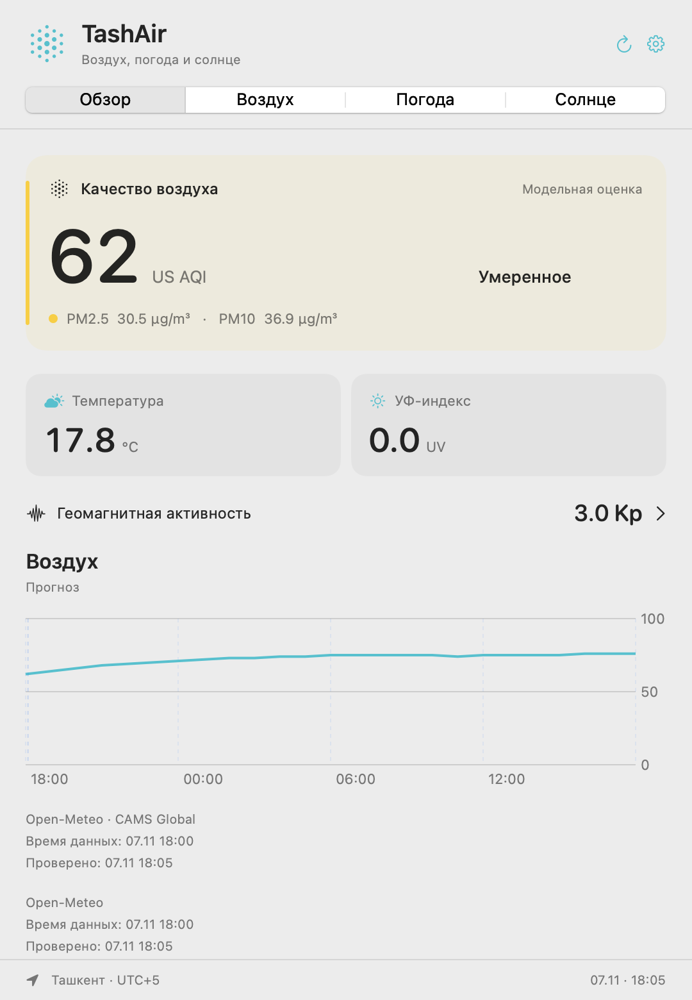

# TashAir

**Воздух, погода и солнечная активность Ташкента — в строке меню macOS.**

Бесплатное открытое приложение без регистрации, рекламы и аналитики. Версия **0.1.0**, macOS **14+**, Apple Silicon и Intel. Интерфейс: русский и узбекский (латиница).

## Возможности

- US AQI, PM2.5, PM10, пыль, NO₂, SO₂, CO и O₃, суточный график и прогноз воздуха до пяти дней.
- Текущая погода, почасовой прогноз, 7 и 16 дней, архив модельных данных за предыдущие 30 завершённых дней.
- УФ, восход, закат, длина дня и солнечное излучение.
- Глобальный Kp: наблюдения, оценки, прогноз; последние зарегистрированные солнечные вспышки.
- Выбор показателя в строке меню, автозапуск по желанию.
- Пороговые уведомления и ежедневная сводка. Оба режима выключены до включения пользователем.
- Виджеты macOS трёх размеров: выбранный показатель, общая сводка, воздух, погода и солнечная активность.

Воздух представлен **моделью CAMS Global с разрешением около 45 км**. Это оценка территории, не измерение на конкретной улице. История погоды также модельная. Kp и вспышки — глобальные показатели, не локальные измерения над Ташкентом. Источник, время значения, время проверки и сохранённое состояние видны в интерфейсе.



Пример интерфейса от 7 ноября 2026 года. Данные: Open-Meteo / CAMS Global, NOAA SWPC.

## Скачать

**[Скачать TashAir для macOS — DMG](https://github.com/ahrik/tashair/releases/download/v0.1.0/TashAir.dmg)** · [ZIP](https://github.com/ahrik/tashair/releases/download/v0.1.0/TashAir-macOS.zip) · [SHA256SUMS](https://github.com/ahrik/tashair/releases/download/v0.1.0/SHA256SUMS)

Универсальная сборка для Apple Silicon и Intel. [Инструкция установки](docs/INSTALLATION.md). Подпись локальная (ad hoc), без нотариализации Apple.

## Сборка и запуск

Нужен полный Xcode со Swift 6 и macOS SDK. Сторонние библиотеки не требуются.

```sh
bash scripts/swift.sh test
bash scripts/build-app.sh
open temp/outputs/TashAir.app
```

Универсальный установочный образ:

```sh
TASHAIR_UNIVERSAL=1 bash scripts/build-dmg.sh
python3 scripts/check-distribution.py --universal
```

Результаты: `temp/outputs/TashAir.app`, `TashAir.dmg`, `TashAir-macOS.zip`, `SHA256SUMS`. Сборка по умолчанию подписана локально (ad hoc); Developer ID и нотариализация пока не выполнены. Смотрите [установку](docs/INSTALLATION.md).

## Документация

**[Книга документации](https://ahrik.github.io/tashair/)** — установка, руководство, виджеты, уведомления и источники данных. Есть оглавление и поиск.

- [Руководство пользователя](docs/USER_GUIDE.md)
- [Виджеты macOS](docs/WIDGETS.md)
- [Уведомления](docs/ALERTS.md)
- [Источники, методика и условия использования](docs/DATA_SOURCES.md)
- [Конфиденциальность](docs/PRIVACY.md)
- [Сборка, тесты и участие](CONTRIBUTING.md)
- [История изменений](CHANGELOG.md)
- [Публикация владельцем](docs/PUBLISHING.md)

## Открытый проект

Код и документация — [MIT](LICENSE). Права на данные определяются отдельно их поставщиками. Бесплатный API Open-Meteo рассчитан на некоммерческое использование; открытость исходников сама по себе не разрешает бесплатное использование API коммерческими форками.

Исходники опубликованы в [ahrik/tashair](https://github.com/ahrik/tashair). Следующее направление — подключение реальных станций при подтверждённом доступе к данным.

**English:** TashAir is a free, open-source macOS menu bar app for Tashkent air quality, weather, UV and global space weather. It uses model data from Open-Meteo/CAMS and observations and forecasts from NOAA SWPC. Russian and Uzbek UI; MIT-licensed source.
