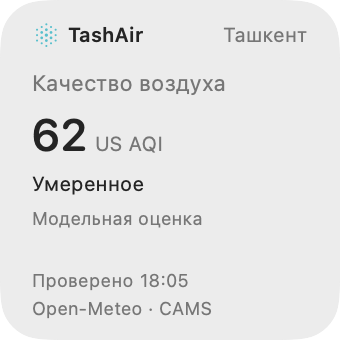
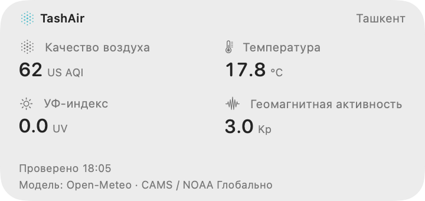
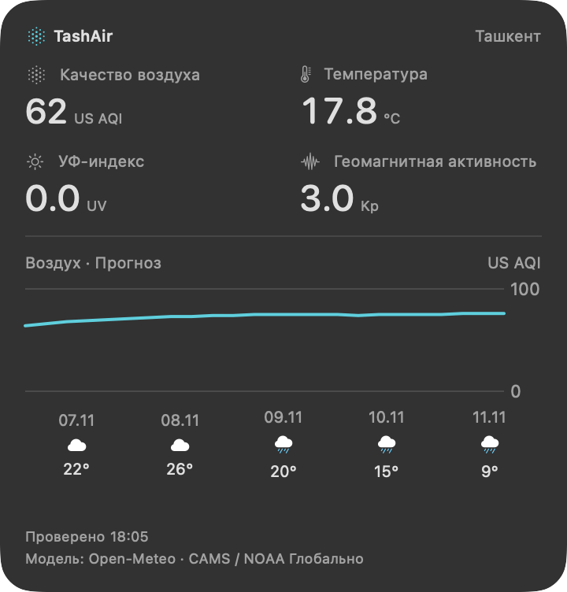

# Виджеты macOS

TashAir поддерживает виджеты рабочего стола и Центра уведомлений в macOS 14 и новее. Они запрашивают данные самостоятельно и продолжают работать, когда основная панель закрыта. Частоту обновления назначает macOS.

## Добавление

1. Установите TashAir в «Программы» и запустите один раз.
2. Откройте галерею виджетов macOS через контекстное меню рабочего стола или Центр уведомлений.
3. Найдите TashAir, выберите общий виджет либо «Воздух», «Погода», «Солнечная активность», затем размер и добавьте виджет.
4. Через «Изменить виджет» выберите язык, а для маленького размера общего виджета — показатель.

Если TashAir не появляется в галерее, проверьте, что запускаете установленную копию из «Программ», а не приложение внутри смонтированного DMG. Расширение виджетов входит в комплект приложения.

## Маленький: один показатель

US AQI, PM2.5, температура, УФ или Kp. Под значением указаны тип данных, источник и время проверки. Нажатие открывает соответствующий раздел TashAir.

## Средний: сводка по Ташкенту

Качество воздуха, температура, УФ и Kp. Каждая метрика открывает свой раздел; нажатие на остальную область открывает общий обзор.

## Большой: сводка и прогноз

Те же четыре метрики, график прогноза воздуха на ближайшие сутки и погода на пять дней.

Снимки интерфейса от 7 ноября 2026 года. Данные: Open-Meteo / CAMS Global, NOAA SWPC.

## Отдельные виджеты

Каждый доступен в маленьком, среднем и большом размере. Язык настраивается отдельно; данные обновляются и при закрытой панели приложения.

- **Воздух:** US AQI и категория качества. Средний размер добавляет PM2.5, PM10 и пыль; большой — почасовой прогноз AQI на сутки. Нажатие открывает воздух.
- **Погода:** температура, состояние неба, минимум и максимум на сегодня. Средний размер добавляет ощущаемую температуру, ветер и суточные осадки; большой — почасовую температуру на сутки и прогноз на пять дней. Нажатие открывает погоду.
- **Солнечная активность:** текущий УФ, восход и закат по Ташкенту. Средний размер добавляет глобальный Kp, максимум УФ на сегодня и последнюю зарегистрированную вспышку с датой; большой — прогноз Kp. Основная область открывает солнце, Kp и вспышки — космическую погоду.

Воздух запрашивает только CAMS, погода — только Open-Meteo, солнечная активность — Open-Meteo и NOAA. Время проверки и состояние сохранённых данных относятся к источникам соответствующего виджета. Для солнечной активности УФ и время восхода/заката местные, Kp и вспышки — глобальные. Пустой ответ по вспышкам не означает отсутствие солнечной активности.

## Сохранённые и отсутствующие данные

«Проверено» — время последней успешной проверки источника. Пометка «Сохранённые данные» появляется при ошибке запроса или превышении срока актуальности. `—` означает, что значения нет; демонстрационные числа в рабочий виджет не подставляются.

Язык и показатель каждого виджета настраиваются отдельно от основной программы. У расширения свой кэш, поэтому значения и время проверки могут немного отличаться от панели. Система может задерживать обновление для экономии энергии.

Данные воздуха и погоды модельные. Kp — глобальный показатель. Подробности — в [источниках и методике](DATA_SOURCES.md).
