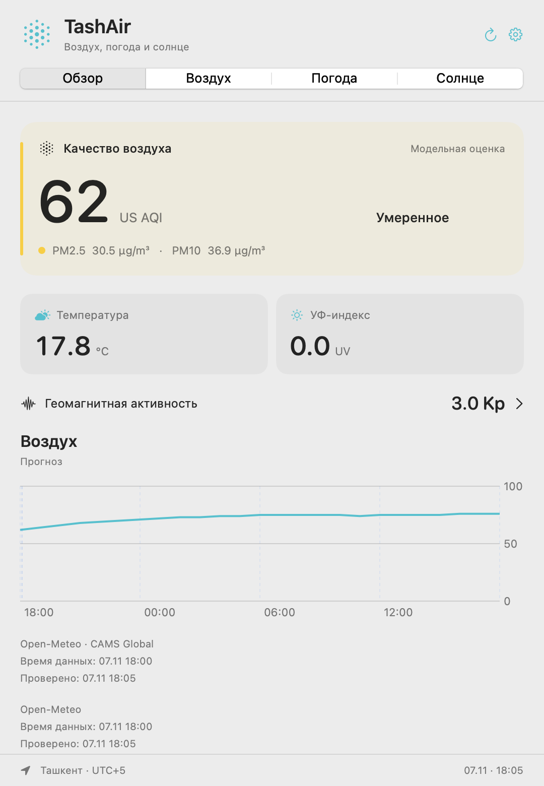

# TashAir

Воздух, погода и солнце Ташкента в строке меню Mac.

Посмотрите качество воздуха, прогноз погоды, УФ и солнечную активность в одной панели. TashAir работает бесплатно, без регистрации, рекламы и аналитики. Код открыт под MIT.

<a class="download" href="../docs/INSTALLATION.md">Установить TashAir</a><a href="../docs/USER_GUIDE.md">Открыть руководство</a>

Версия 0.1.0. macOS 14 и новее, Apple Silicon и Intel. Интерфейс на русском и узбекском. Сборка пока с локальной подписью, без нотариализации Apple.

Пример интерфейса от 7 ноября 2026 года. Данные: Open-Meteo / CAMS Global, NOAA SWPC.

## Начните с нужного раздела

- **[Установка](../docs/INSTALLATION.md):** как собрать приложение, открыть DMG и перенести его в «Программы».
- **[Руководство](../docs/USER_GUIDE.md):** строка меню, показатели, прогнозы и история за 30 дней.
- **[Виджеты macOS](../docs/WIDGETS.md):** три размера, выбор языка и показателя.
- **[Уведомления](../docs/ALERTS.md):** пороги, ежедневная сводка и ограничения доставки.

## Что показывает приложение

**Воздух.** US AQI, PM2.5, PM10, пыль и основные газы. График за сутки и прогноз до пяти дней. Это модельная оценка CAMS Global для территории, а не измерение на конкретной улице.

**Погода.** Текущие условия, почасовой прогноз, 7 и 16 дней. Отдельно — модельный архив за предыдущие 30 завершённых дней.

**Солнце.** УФ, восход и закат, длина дня, солнечное излучение. Космическая погода включает глобальный Kp и последние зарегистрированные солнечные вспышки NOAA.

## Откуда берутся данные

TashAir обращается к Open-Meteo и NOAA напрямую с Mac. Показывает источник, время данных и время проверки. При сетевой ошибке остаётся последний успешный ответ с пометкой о сохранённых данных.

Читайте [источники и методику](../docs/DATA_SOURCES.md), чтобы понимать точность моделей, единицы и различие между прогнозом и наблюдением. [Конфиденциальность](../docs/PRIVACY.md) объясняет сетевые обращения и локальное хранение.

## Для участников проекта

[Сборка и тесты](../CONTRIBUTING.md), [история изменений](../CHANGELOG.md), [лицензия MIT](../LICENSE). Правила использования данных определяются отдельно их поставщиками.
